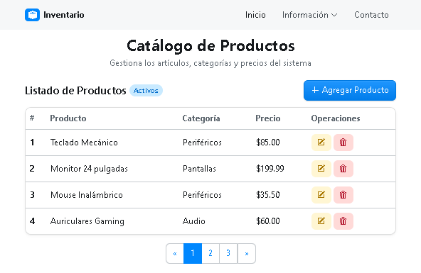
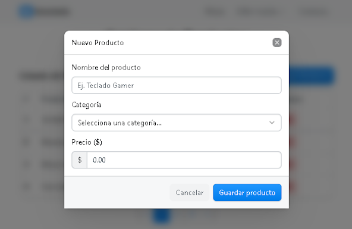

# Catálogo de Productos

Proyecto demostrativo de un sistema CRUD ficticio, centrado en el diseño mediante Bootstrap 6.

La web presenta una tabla de productos con datos de ejemplo, un modal para el registro de nuevos artículos y acciones de edición y eliminación.

## Ejecución

La web se encuentra en un único archivo `index.html`, por lo que no requiere instalación, basta con abrirlo en cualquier navegador moderno para su visualización.
